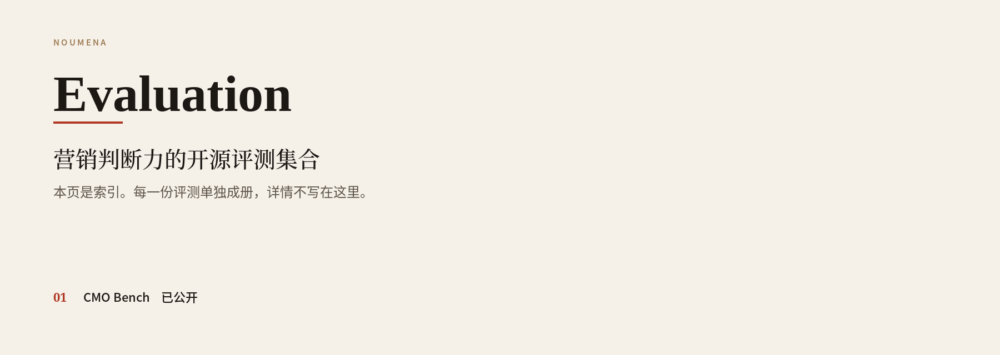

<p align="center">
  
  
</p>

<p align="center">
  <strong>简体中文</strong> · <a href="README_EN.md">English</a>
</p>

<p align="center">
  物自体开源的营销判断力评测集合。<br>
  本页是索引。每一份评测单独成册。
</p>

<p align="center">
  <a href="https://github.com/Noumena-Marketing-AI/noumena-evaluation/stargazers"></a>
  
</p>

<p align="center">
  <a href="#物自体">物自体</a>
  &nbsp;·&nbsp;
  <a href="#这个集合">这个集合</a>
  &nbsp;·&nbsp;
  <a href="#评测索引">评测索引</a>
  &nbsp;·&nbsp;
  <a href="#目录约定">目录约定</a>
</p>



<a id="物自体"></a>

## 物自体

物自体科技（Noumena）成立于 2023 年，聚焦增长智能（Growth Intelligence），构建面向营销决策与执行的 AI Agent。团队由 AI 研究、算法工程和一线营销业务人员共同组成，长期待在品牌的真实业务里，把洞察、内容、达人合作、投放和复盘中的经验，沉淀成可学习、可进化的增长系统。

公开邮箱：[hello@noumena.com.cn](mailto:hello@noumena.com.cn)

<a id="这个集合"></a>

## 这个集合

Noumena Evaluation 用来公开营销判断力评测。它不是某一份榜单的主页。

每份评测回答自己的问题，带自己的题库、判据和结果。根 README 只说明这是谁、现在有哪些册、到哪里读详情。方法、总榜、案例和共创方式，都写在该评测自己的材料里。

新评测加入时，本页增加一张简介。已经公开的评测，不在这里改写。

<a id="评测索引"></a>

## 评测索引

| 编号 | 评测 | 问的问题 | 详情 |
| --- | --- | --- | --- |
| 01 | [CMO Bench](benchmarks/cmo-bench/README.md) | 模型能不能按 CMO 级专家的标准做营销判断 | [中文](benchmarks/cmo-bench/README.md) · [English](benchmarks/cmo-bench/README_EN.md) |

### 01 · CMO Bench

<a href="benchmarks/cmo-bench/README.md">
  
</a>

物自体科技与香港科技大学宋阳秋教授课题组联合完成。它是这个集合的第一份评测，以从业十年以上的 CMO 级专家亲手写下的判据为满分。题目来自头部品牌的真实业务，经脱敏改编。

首期可以先记住一句：执行近满分，拍板只对一半。

[阅读 CMO Bench](benchmarks/cmo-bench/README.md) · [English](benchmarks/cmo-bench/README_EN.md) · [榜单页](https://solution.alphacat.pro/cmo-bench-hkust)

<a id="目录约定"></a>

## 目录约定

```text
README.md                          集合索引，中文默认
README_EN.md                       集合索引，英文
benchmarks/<bench>/README.md       该评测的中文详情
benchmarks/<bench>/README_EN.md    该评测的英文详情
benchmarks/<bench>/assets/         只服务这一册
```

加一份评测：新建 `benchmarks/<bench>/`，再在上面的索引里加一张简介。不要把新评测的方法、榜单和案例写进根 README。

## 联系

写到 [hello@noumena.com.cn](mailto:hello@noumena.com.cn)。标题注明评测名称和你的身份。怎么参与，以该评测详情里的共创说明为准。

## 引用

```text
Noumena. Noumena Evaluation.
2026.
https://github.com/Noumena-Marketing-AI/noumena-evaluation
```
