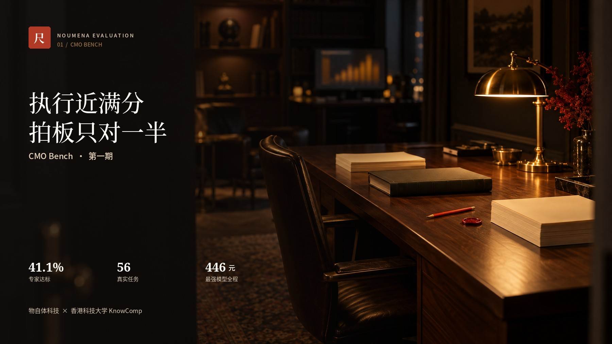
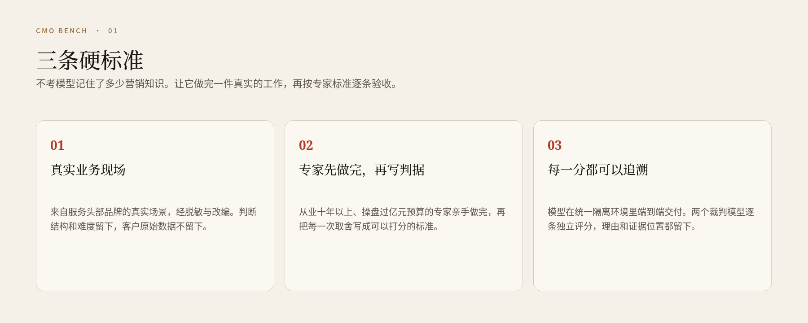
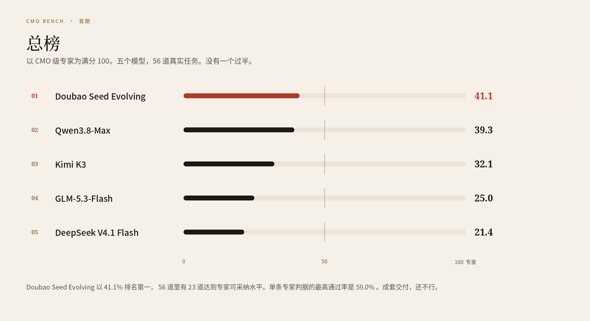
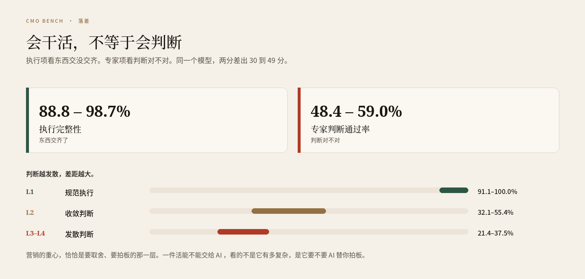
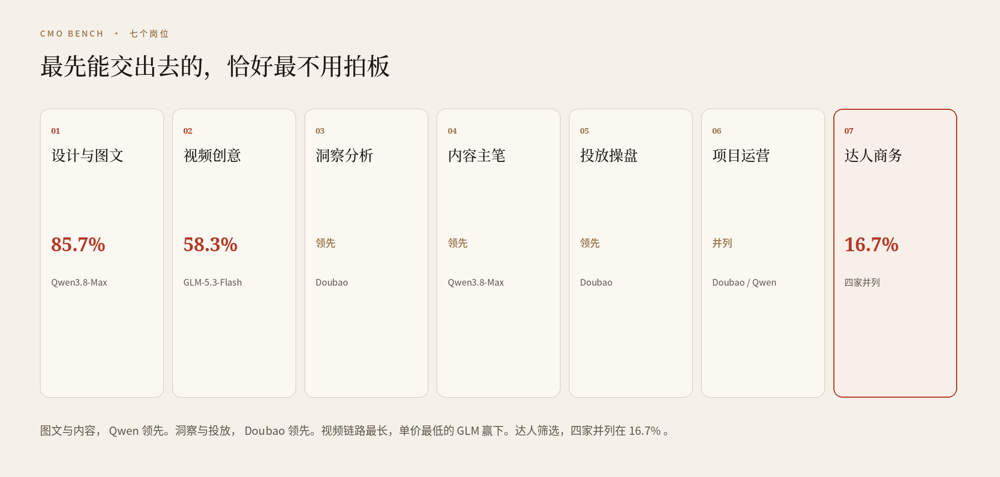
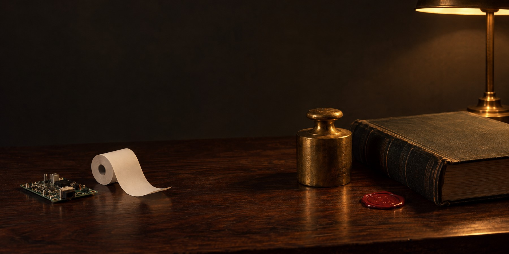
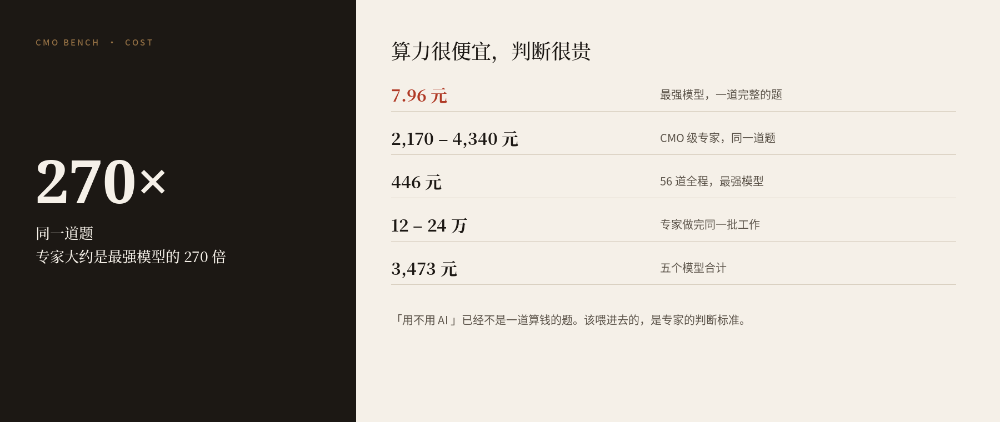
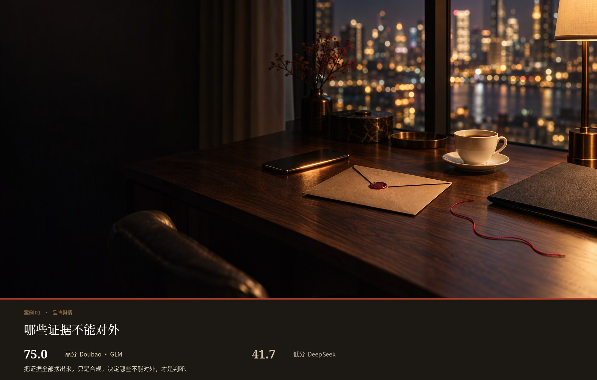
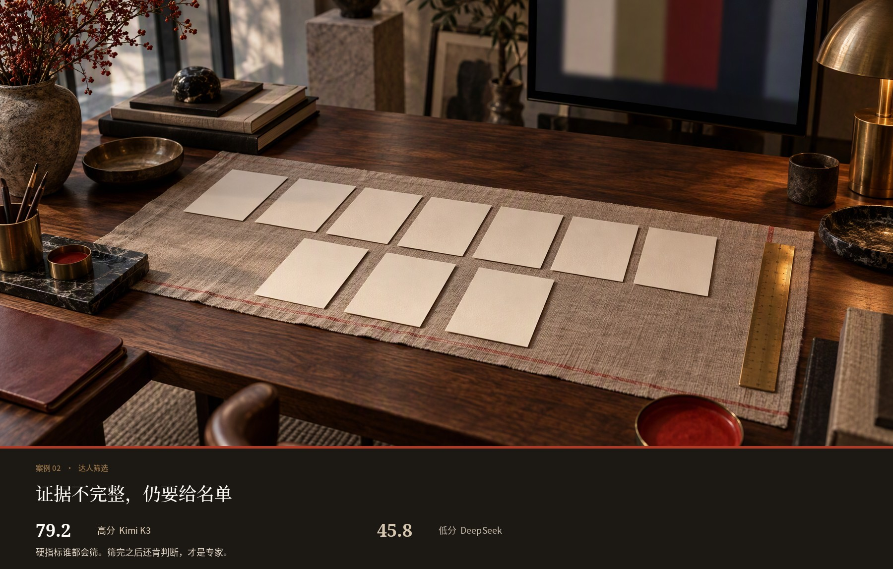

<p align="center">
  
  
</p>

<p align="center">
  <strong>简体中文</strong> · <a href="README_EN.md">English</a>
</p>

<p align="center">
  开源的营销判断力评测集合。<br>
  第一期，是一把以 CMO 级专家为满分的尺子：<strong>CMO Bench</strong>。
</p>

<p align="center">
  <a href="https://solution.alphacat.pro/cmo-bench-hkust"></a>
  
  
  
  <a href="https://github.com/Noumena-Marketing-AI/noumena-evaluation/stargazers"></a>
</p>

<p align="center">
  <a href="#是什么">是什么</a>
  &nbsp;·&nbsp;
  <a href="#为什么需要这把尺">为什么</a>
  &nbsp;·&nbsp;
  <a href="#考卷怎么出">怎么考</a>
  &nbsp;·&nbsp;
  <a href="#首期总榜">总榜</a>
  &nbsp;·&nbsp;
  <a href="#两个案例">案例</a>
  &nbsp;·&nbsp;
  <a href="#一起来定">共创</a>
</p>



<a id="是什么"></a>

## Noumena Evaluation 是什么

Noumena Evaluation 是物自体科技（Noumena）发起的开源评测集合。它要回答的不是「模型会不会聊天」，而是：在预算、时间、品牌和合规都真的会出事的营销现场里，模型能不能做出可以承担后果的判断。

第一期公开的是 **CMO Bench**。

物自体科技联合香港科技大学宋阳秋教授课题组，把服务头部品牌的真实业务场景经脱敏改编做成题库，由从业十年以上的 CMO 级专家亲手判分。这是第一个专注营销垂类、以 CMO 级专家判断为满分标尺的大模型评测。

题库覆盖七类岗位：设计与图文、视频创意、洞察分析、内容主笔、投放操盘、项目运营、达人商务。

首期可以先记住三句：

- 最强的模型，已经能独立交付约四成资深营销工作。
- 执行接近满分，拍板只对一半。
- 跑完全部 56 组任务，最强模型只花了 446 元。

完整榜单、方法与逐项结果：[solution.alphacat.pro/cmo-bench-hkust](https://solution.alphacat.pro/cmo-bench-hkust)

<a id="为什么需要这把尺"></a>

## 为什么需要这把尺

代码对不对，跑一下就知道。所以 Coding Agent 的进步可以被验证。营销正好相反。平台在变，经验还没来得及沉淀，适用条件就已经变了。真正有用的判断，藏在品牌用真实预算换来的投放数据、项目复盘和专家经验里，很少进入公开语料。

这不是一块小市场。WARC 预计，2026 年全球广告投入将达到 1.30 万亿美元。Gartner 的 2026 年 CMO 调查显示，受访企业的营销预算平均占营收 7.8%。营销连接的是产品、用户与收入：服务谁、讲什么、预算投向哪里，何时放量、何时止损。一次判断失误，损失的可能是一轮新品窗口，甚至长期积累的品牌心智。

企业已经在用 AI 写内容、做分析、选达人、管投放。缺的是下一问：这个模型只是把任务做完了，还是已经能在约束下拍板？

CMO Bench 要回答的就是这一问。它参照国际专家型基准来设计：不考模型记住了多少营销知识，而是让它完成一项真实工作，再按专家标准逐条验收。

<a id="考卷怎么出"></a>

## 考卷怎么出



- **题目来自真实业务现场。** 基于服务头部品牌的真实场景，经脱敏和改编合成。判断结构与难度留下，不含任何客户原始数据。
- **判据由专家完成任务后写下。** 从业十年以上、操盘过亿元预算的营销专家先亲手做完，再逐条写下评分标准。每条判据对应真实工作里的一次取舍。
- **每一分都可以追溯。** 模型在统一的隔离环境中端到端交付，再由两个裁判模型对照专家判据逐条独立评分。每项判断都留下理由和证据位置。

<a id="首期总榜"></a>

## 首期总榜

以 CMO 级专家为满分 100。五个模型在统一隔离环境里，端到端完成全部 56 道真实任务。



**Doubao Seed Evolving 以 41.1% 的专家达标率排名第一。** 56 道任务里，有 23 道达到专家可采纳水平。Qwen3.8-Max 以 39.3% 紧随其后。五个模型全部没有过半。

单条专家判据的最高通过率是 59.0%。单条判断可以过半，成套交付还不行。

| 排名 | 模型 | 专家达标率 |
| --- | --- | --- |
| 1 | Doubao Seed Evolving | 41.1% |
| 2 | Qwen3.8-Max | 39.3% |
| 3 | Kimi K3 | 32.1% |
| 4 | GLM-5.3-Flash | 25.0% |
| 5 | DeepSeek V4.1 Flash | 21.4% |

同一批工作如果由专家完成，大约是 12 万到 24 万元。五个模型合计 3,473 元。最强的那个，全程 446 元，不到专家的 1/270。

## 会干活，不等于会判断

五个模型的基础执行完整性都在 88.8%–98.7%，专家判断通过率只有 48.4%–59.0%。同一个模型，这两个分数差出 30 到 49 分。执行项查的是东西交没交齐。专家项查的是判断对不对。这段落差，就是今天还必须由人补上的那部分。



判断越发散，差距越大。执行层达标率 91.1%–100%，收敛判断 32.1%–55.4%，到了需要取舍、拍板的发散判断，只剩 21.4%–37.5%。营销的重心，恰恰是这一层。

所以一件活能不能交给 AI，看的不是它有多复杂，是它要不要 AI 替你拍板。

## 七个岗位

AI 最先能独立交付的，是设计与图文岗（85.7%）和视频创意岗（58.3%）。最难接手的，是达人商务岗（16.7%）。规范化的产出已经能做。一旦涉及「什么不能画、什么不能写」，它就塌了。

工具能解决产能，解决不了边界判断。真正吃预算的广告投放、达人投放，不会因为只买一套生成工具而变好。



每个场景的领先者也不一样。Qwen3.8-Max 领先图文与内容。Doubao Seed Evolving 领跑洞察与策略。单价最低的 GLM-5.3-Flash，反而赢下了生成链路最长的视频场景。项目运营是 Doubao 和 Qwen 并列。达人筛选，四家并列在 16.7%。

要搭一支 AI Native 的营销团队，可以按场景选用模型，而不是押一个总分。

## 算力很便宜，判断很贵

一道题就是一件完整的营销工作：从看材料，到交出成品。





最强的模型跑完一整道题只要 **7.96 元**。同一道题，CMO 级专家大约 **2,170 到 4,340 元**，差出约 270 倍。便宜到这个程度，「用不用 AI」已经不是一道算钱的题。

该花力气的，不是再挑一个更便宜的模型，而是把专家判断标准喂进去，让 AI 不断接近专家的判断水平。

<a id="两个案例"></a>

## 两个案例

高分和低分，差的往往不是文件齐不齐，而是哪一步肯不肯拍板。下面的照片是任务现场的视觉转译，不是模型交付原件。分数来自首期评测。

### 快速处理品牌舆情

一条未经证实的产品质量投诉正在发酵。检测报告还没出，客服记录和用户说法对不上。今晚之前，要拿出一套能直接用的首轮回应。



高分是 75.0，Doubao Seed Evolving 与 GLM-5.3-Flash 同在这一档。它们把客服记录留在内部，安排专人跟进，并为不利的检测结果预置了口径切换。

低分是 41.7，DeepSeek V4.1 Flash。四件交付齐全，却在对外 FAQ 里逐条列出客服私信时间，等于公开指认投诉用户说法不实。

**把证据全部摆出来，只是合规动作。决定哪些证据不能对外，才是专家判断。**

### 为新品筛选达人

按品牌 brief，从 8 位候选达人中筛出 4 到 6 位。每个选择都要有看得见的依据。素材里，有些视频很短，画质也一般。



高分是 Kimi K3，79.2 分。它逐位覆盖，给出四类名单，归类都有画面或日期作依据。

低分是 45.8。模型只按一两条硬规则排除，之后不再判断，13 处名单层判断全部缺失。

**硬指标谁都会筛。在证据不完整时仍能给出有依据的名单，才是专家判断。**

<a id="一起来定"></a>

## 这把尺，欢迎一起来定

CMO Bench 按季度更新。我们邀请三类伙伴：

| 你是谁 | 你可以做什么 |
| --- | --- |
| 营销专家 | 出题，并写下判据。被采纳的题目在榜单页署名。 |
| 模型厂商 | 提交接口参评。是否公开排名，由你决定。 |
| 研究者 | 围绕营销判断开展联合研究。 |

邮件 [hello@noumena.com.cn](mailto:hello@noumena.com.cn)，标题注明「CMO-Bench」和你的身份。

## 联合研究团队

**物自体科技（Noumena）** 成立于 2023 年，聚焦增长智能（Growth Intelligence），构建面向营销决策与执行的 AI Agent。团队由 AI 研究、算法工程与一线营销业务人员共同组成，长期待在品牌的真实业务里，把洞察、内容、达人合作、投放与复盘中的经验，沉淀成可学习、可进化的增长系统。

在 CMO Bench 中，物自体负责从真实业务里提炼评测场景，组织资深营销专家完成作答与判据设计，并搭建模型测试和逐项复核流程。

**香港科技大学 KnowComp（Knowledge Computing）研究组** 由宋阳秋副教授带领，长期研究知识图谱、知识表示与推理、自然语言处理和机器学习。团队正在探索从 Foundation Knowledge Graphs 到 Foundation Knowledge Models 的路径，并进一步关注可信 AI 与行为合规：把规则变成智能体可以推理、可以审计的约束，让行为从 “Trust Me” 走向 “Verify Me”。

## 这个仓库现在有什么

这是集合仓库的第一期门面。当前公开的是 CMO Bench 的问题定义、方法口径和首期结果。

题库、判据与评测工具随后放出。许可协议随评测包一起确定。欢迎先参与共创，不必等代码。

## 引用

```text
Noumena & HKUST KnowComp. CMO Bench.
Noumena Evaluation, 2026.
https://github.com/Noumena-Marketing-AI/noumena-evaluation
```
