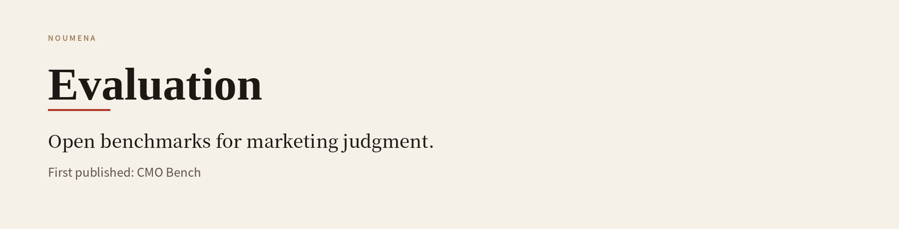
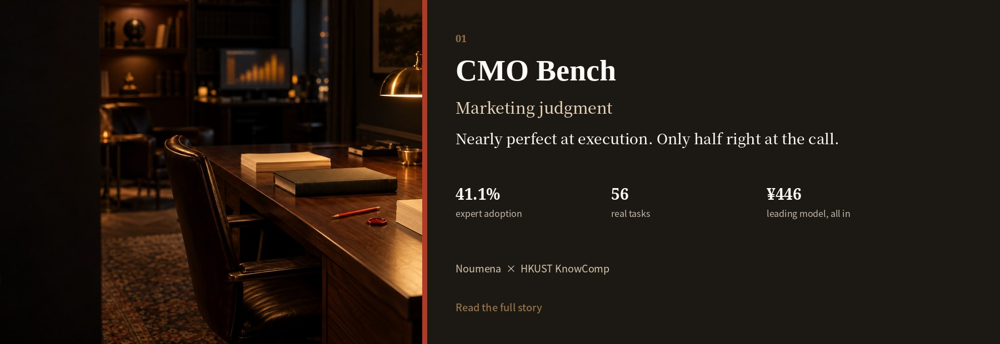

  
  

  <a href="README.md">简体中文</a> · <strong>English</strong>

  Open benchmarks for marketing judgment, from Noumena. 
  First published: <a href="benchmarks/cmo-bench/README_EN.md"><strong>CMO Bench</strong></a>.

  
  

  <a href="#noumena">Noumena</a>
  &nbsp;·&nbsp;
  <a href="#cmo-bench">CMO Bench</a>
  &nbsp;·&nbsp;
  <a href="#coming-soon">Coming soon</a>
  &nbsp;·&nbsp;
  <a href="#work-with-us">Work with us</a>

## Noumena

Noumena was founded in 2023. We work on Growth Intelligence: agents for marketing decisions, and for the work that follows them. The team mixes AI research, engineering, and people who still do the marketing. Insight, content, creators, media, and postmortems are where the judgments live that rarely make it into a textbook.

Noumena Evaluation is where we turn those judgments into exams and publish them. The question is not how much marketing theory a model remembers. It is whether the model can finish a real piece of work, and make the tradeoffs, under budget, time, and brand constraints.

## First published: CMO Bench

If you have already seen the result, this is the longer account.

CMO Bench was built by Noumena with Professor Yangqiu Song’s KnowComp group at the Hong Kong University of Science and Technology. The tasks come from real work for leading brands, then desensitized and rewritten. The people who scored them have more than ten years in the field, and have run hundred-million-yuan budgets. They finished the work themselves, then wrote each tradeoff down as a criterion. Five models completed all 56 tasks, end to end, in the same isolated setting.

The full write-up has what a short announcement cannot hold: how the exam was set, the 30-to-49-point gap between finishing and judging, and two cases where the high score and the low score diverge at a single decision.

[Read CMO Bench](benchmarks/cmo-bench/README_EN.md) · [中文](benchmarks/cmo-bench/README.md) · [Board](https://solution.alphacat.pro/cmo-bench-hkust)

## Coming soon

**A public slice of the exam.** The first results are already out. Next we will publish a portion of the original tasks, so you can see how a brief is written, what the materials look like, and what has to be handed over. Enough to tell whether this exam resembles your own work. The scoring criteria and the full task set stay with the evaluation. They will not ship with this first public slice.

**More benchmarks.** Marketing judgment is not one exam. New ones will be published here, each with its own question and its own results.

To hear when the tasks are public, write to [hello@noumena.com.cn](mailto:hello@noumena.com.cn) with the subject “CMO-Bench tasks”.

## Work with us

Three ways in. The ruler is updated quarterly.

**Submit a model.** Tell us who you are, the model’s name, and an endpoint we can call. The next round runs the same tasks, in the same way. You decide whether the rank appears on the public board.

**Set a question.** If you have made marketing judgments that had to live with a budget, you can write a task and the criteria you would grade it by. Adopted tasks are credited on the board.

**Research together.** On how marketing judgment can be measured, and how it can be learned. The research team on CMO Bench is Noumena and HKUST KnowComp.

Write to [hello@noumena.com.cn](mailto:hello@noumena.com.cn). Put the benchmark and your role in the subject, for example “CMO-Bench evaluation”. The same invitation is at the end of the [CMO Bench write-up](benchmarks/cmo-bench/README_EN.md#work-with-us).
