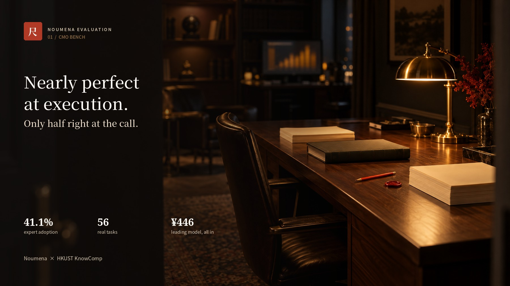
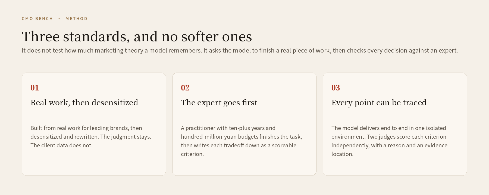
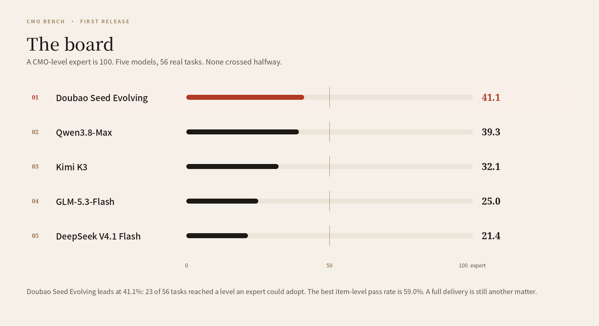
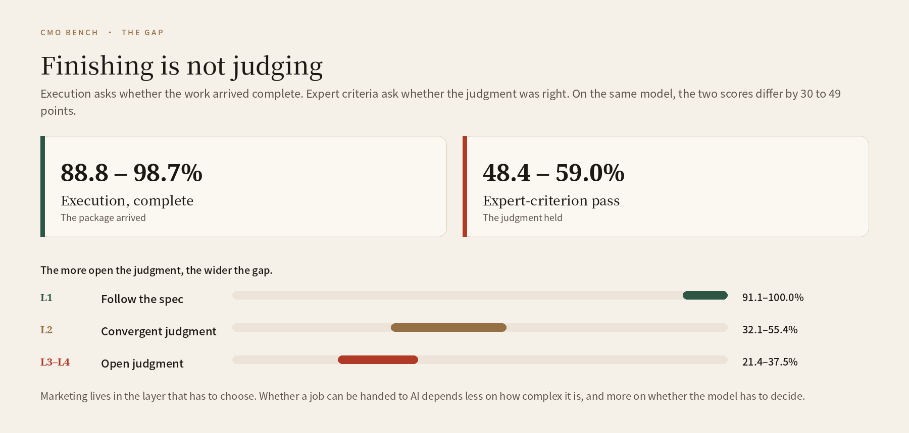
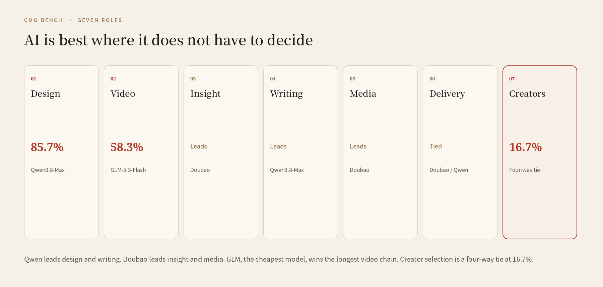
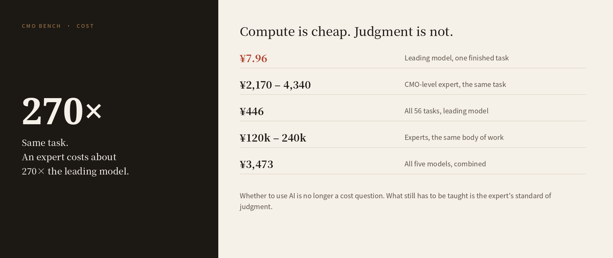
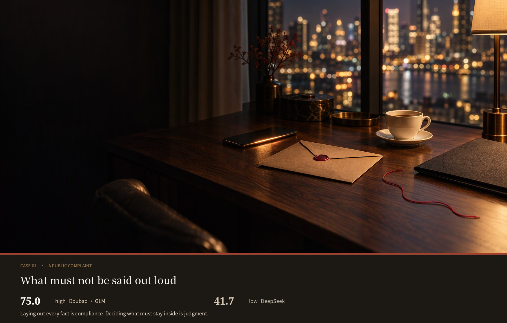
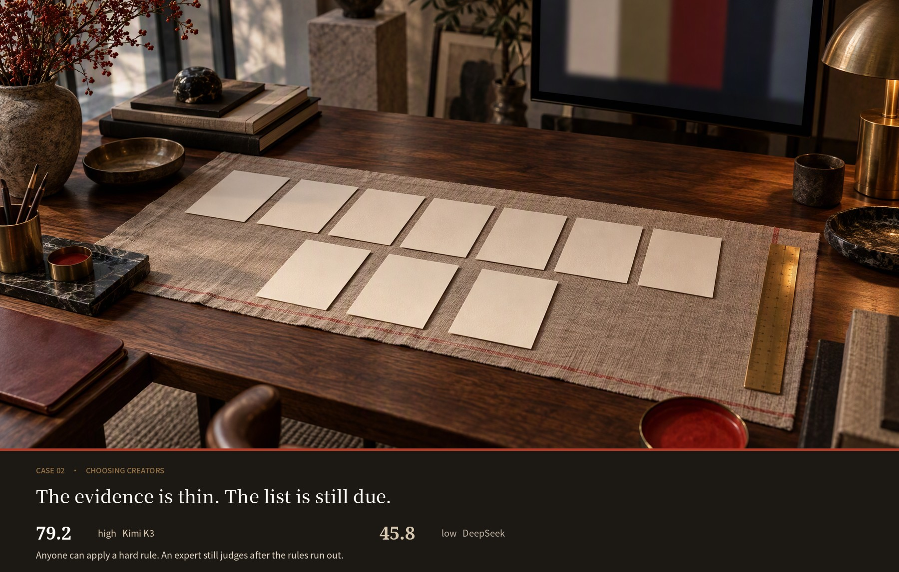

<p align="center">
  <a href="../../README_EN.md">Noumena Evaluation</a>
  &nbsp;·&nbsp;
  <strong>CMO Bench</strong>
</p>

<p align="center">
  <a href="README.md">简体中文</a> · <strong>English</strong>
</p>

<p align="center">
  A marketing-judgment benchmark scored against a CMO-level expert.<br>
  The first volume of Noumena Evaluation. Method, results, and cases live only here.
</p>

<p align="center">
  <a href="https://solution.alphacat.pro/cmo-bench-hkust"></a>
  
  
  
</p>

<p align="center">
  <a href="#the-question">The question</a>
  &nbsp;·&nbsp;
  <a href="#how-it-is-set">How it is set</a>
  &nbsp;·&nbsp;
  <a href="#the-board">The board</a>
  &nbsp;·&nbsp;
  <a href="#two-cases">Cases</a>
  &nbsp;·&nbsp;
  <a href="#join">Join</a>
</p>



<a id="the-question"></a>

## The question

If a year of marketing problems from leading brands were set as an exam, what would today’s models score? The missing piece is not whether the files arrive complete. It is whether the model can make a judgment it would have to live with, where budget, time, brand, and compliance all have consequences.

Noumena built this volume with Professor Yangqiu Song’s KnowComp group at the Hong Kong University of Science and Technology. Real work for leading brands was desensitized and rewritten into tasks. CMO-level practitioners, each with more than ten years in the field, scored them by hand. It is the first benchmark focused on marketing, with a CMO-level expert as the perfect score.

The set covers seven roles: design and graphics, video creative, insight, writing, media, project delivery, and creator partnerships.

Three lines from the first release:

- The strongest model can already deliver about four tenths of senior marketing work on its own.
- Execution is nearly perfect. The call is only half right.
- The leading model finished all 56 tasks for ¥446.

Full board, method, and item-level results: [solution.alphacat.pro/cmo-bench-hkust](https://solution.alphacat.pro/cmo-bench-hkust)

## Why marketing needs this ruler

Code is easy to grade. Run it. Marketing is not. Platforms move, and the experience has often not settled before the conditions change. The judgments that matter sit in spend data, postmortems, and expert memory. Very little of that enters public training text.

The market is not small. WARC expects global advertising spend to reach $1.30 trillion in 2026. Gartner’s 2026 CMO survey puts the average marketing budget at 7.8% of revenue. Marketing is the link between product, audience, and revenue: who to serve, what to say, where the money goes, when to scale, when to stop. One bad call can cost a launch window, or a brand association that took years to build.

Companies already use AI to write, analyze, pick creators, and run media. The missing question is the next one. Did the model merely finish the assignment, or can it decide under constraints?

CMO Bench follows the design of expert benchmarks used elsewhere: not a quiz of remembered marketing theory, but a piece of real work, accepted line by line against an expert standard.

<a id="how-it-is-set"></a>

## How the paper is set



- **The tasks come from real work.** They are drawn from engagements with leading brands, then desensitized and rewritten. The structure and the difficulty stay. No client source data is included.
- **The criteria are written after the expert finishes.** Practitioners with ten-plus years, and with experience running hundred-million-yuan budgets, do the task themselves, then write down each tradeoff as a scoreable criterion.
- **Every point can be traced.** Models deliver end to end in one isolated environment. Two judge models score each criterion independently. Each judgment keeps a reason and a location in the evidence.

<a id="the-board"></a>

## The first board

A CMO-level expert is 100. Five models finished all 56 tasks, end to end, in the same isolated setting.



**Doubao Seed Evolving leads, at 41.1% expert adoption.** Twenty-three of the 56 tasks reached a level an expert could adopt. Qwen3.8-Max follows at 39.3%. None of the five crossed halfway.

The best pass rate on individual expert criteria is 59.0%. A single judgment can clear the midpoint. A finished piece of work still cannot.

| Rank | Model | Expert adoption |
| --- | --- | --- |
| 1 | Doubao Seed Evolving | 41.1% |
| 2 | Qwen3.8-Max | 39.3% |
| 3 | Kimi K3 | 32.1% |
| 4 | GLM-5.3-Flash | 25.0% |
| 5 | DeepSeek V4.1 Flash | 21.4% |

The same body of work, done by experts, would cost about ¥120,000 to ¥240,000. The five models together cost ¥3,473. The leader spent ¥446 for the full run, less than 1/270 of the expert cost.

## Finishing is not judging

Execution completeness sits between 88.8% and 98.7%. Expert-criterion pass rates sit between 48.4% and 59.0%. On the same model, the two scores differ by 30 to 49 points. Execution asks whether the package arrived complete. Expert criteria ask whether the judgment was right. That gap is the part a person still has to fill.



The more open the judgment, the wider the gap. Spec-following lands at 91.1%–100%. Convergent judgment falls to 32.1%–55.4%. Open judgment, the kind that has to choose, is left at 21.4%–37.5%. That last layer is where marketing actually lives.

Whether a job can be handed to AI depends less on how complex it is, and more on whether the model has to make the call.

## Seven roles

AI can first be left alone on design and graphics (85.7%) and video creative (58.3%). Creator partnerships are the hardest to hand over (16.7%). Standardized output is already within reach. The moment the question becomes what must not be drawn, or what must not be written, the score collapses.

Tools can raise capacity. They do not settle a boundary. Media spend and creator spend will not improve just because a team bought a generator.



The leader changes by scene. Qwen3.8-Max leads design and writing. Doubao Seed Evolving leads insight and strategy. GLM-5.3-Flash, the lowest unit price, wins the longest generation chain, video. Project delivery is a tie between Doubao and Qwen. Creator screening is a four-way tie at 16.7%.

An AI-native marketing team can pick the model by scene, instead of betting the whole org chart on one overall score.

## Compute is cheap. Judgment is not.

One task is one finished piece of marketing work, from reading the brief to handing over the artifact.




The leading model finishes one task for **¥7.96**. A CMO-level expert, on the same task, costs about **¥2,170 to ¥4,340**. About 270 times as much. At that gap, “should we use AI” is no longer a cost question.

The work that remains is to feed the expert’s standard of judgment back in, until the model gets closer to it.

<a id="two-cases"></a>

## Two cases

The distance between a high score and a low score is often not whether the files arrived. It is whether the model was willing to decide. The photographs below are illustrations of the scene, not the models’ deliverables. The scores are from the first release.

### A complaint, before the lab report

An unverified product complaint is spreading. The test report is not back. The support log and the user’s account do not match. A first response that can actually be used is due tonight.



The high score is 75.0, shared by Doubao Seed Evolving and GLM-5.3-Flash. They kept the support log inside, assigned a person to follow up, and prepared a switch in language if the lab result came back badly.

The low score is 41.7, DeepSeek V4.1 Flash. All four deliverables were there. The public FAQ still listed the times of private support messages, which is a public claim that the complainant was not telling the truth.

**Putting every fact on the table is compliance. Deciding which facts must not leave the room is judgment.**

### A shortlist, with thin footage

From a brand brief, choose 4 to 6 creators out of 8. Every choice needs a reason someone else can see. Some of the footage is short. Some of it is poor.



The high score is Kimi K3, at 79.2. It covered each creator, returned four lists, and tied each classification to a frame or a date.

The low score is 45.8. The model excluded people with one or two hard rules, then stopped. Thirteen list-level judgments were simply missing.

**Anyone can apply a hard rule. An expert still produces a reasoned list when the evidence is incomplete.**

<a id="join"></a>

## Help set the ruler

CMO Bench updates quarterly. Three kinds of partners:

| Who | What you can do |
| --- | --- |
| Marketing experts | Set tasks, and write the criteria. Adopted tasks are credited on the board. |
| Model labs | Submit an endpoint. You decide whether the rank is public. |
| Researchers | Joint work on marketing judgment. |

Write to [hello@noumena.com.cn](mailto:hello@noumena.com.cn). Put “CMO-Bench” and your role in the subject.

## The team for this volume

**Noumena** draws the tasks out of real engagements, organizes senior marketers to answer them and write the criteria, and runs the model trials and the item-level review.

**KnowComp (Knowledge Computing) at HKUST**, led by Professor Yangqiu Song, works on knowledge graphs, knowledge representation and reasoning, natural language processing, and machine learning. The group is exploring a path from foundation knowledge graphs to foundation knowledge models, and, as agents begin to act, on trustworthy AI and behavioral compliance: rules an agent can reason over and an auditor can check. From “Trust Me” toward “Verify Me”.

## What this volume contains

What is public now is the question, the method, and the first results. Tasks, criteria, and the evaluation tools will follow. The license will be set with the benchmark package.

Back to the collection: [Noumena Evaluation](../../README_EN.md)

## Citation

```text
Noumena & HKUST KnowComp. CMO Bench.
Noumena Evaluation, 2026.
https://github.com/Noumena-Marketing-AI/noumena-evaluation/tree/main/benchmarks/cmo-bench
```
